# PICKNPLACE_FULL 실습 기록지

이름·조: 정은정 / 4조. 코드 버전: ______. 날짜: 2026-11-10. 실행 대상: 내부 모형 / 세 프로그램 가상장치 / 실물. 학생코드 경로: ______.

## 첫 관측

요청 없이 상태를 먼저 읽는다. PC에 표시되는 원시값·우편함·해석값과 마지막 읽은 시각을 적는다. 실물에서 확인하지 못한 지점에는 미확인이라고 적는다.

| 확인 지점 | 읽은 값·시각 | 확인 방법 |
| --- | --- | --- |
| 로봇 출력 | DO0=0, DO1=0 (DI0~3=0000), 상태 "쉼", PLC 연결됨, 모드 script · 15:28:18.254 | 로봇 8879 화면/`/api/state`. 세 프로그램 가상장치, 실물 미확인 |
| PLC 입력 | P00004=0, P00005=0 (로봇 DO0/DO1 입력), 출력 P00044~P00047=0, M00418=0, RUN · 15:28:18.254 | PLC 8878 디바이스 표/`/api/state`. 실물 미확인 |
| D01000·D01001 | D01000=2, D01001=0 · 15:28:18.254 | PLC 8878 디바이스 표 |
| PC 원시값 | 원시 코드 0002, 우편함 0, 마지막 읽은 시각 15:28:18.088, comm_ok=true, 대상 127.0.0.1:5020 | PC 8877 화면/`/api/status` |
| PC 상태 해석·화면 | "정지 · 열림 · 정상" (robot=1, gripper=0, plc=0, valid), 자동 순서 중 아님, auto_maybe_on=false | PC 8877 화면 |

처음 값이 달라지는 구간: 없음. 로봇 DO0/DO1=0 ↔ PLC P00004/P00005=0 ↔ D01000=2 ↔ PC 0002(정지·열림·정상)가 일치한다. 원인 후보: 해당 없음. 후보를 확인할 다음 행동: 해당 없음. 확인 후 결과: 세 지점 값 일치(가상장치). 실물 배선·장치는 미확인.

## 과제별 기록

| 과제 | 바꾼 함수·판단 | 검사 명령 | 결과와 로그 |
| --- | --- | --- | --- |
| A 명령 결과 | `_accept`: START(1111) 외 명령은 `_until(robot==1, move_timeout)`로 새 정지 관측 후 `_send` 1회. `result=="접수"`일 때만 계속, 거부·미확인은 `Abort("단계: 이유")` | `python -B -X utf8 check_student.py --stage A` | 내부 모형 2026-11-10: PASS 접수 / PASS 거부 / PASS 미확인 / PASS START는 선행 대기 생략 / PASS 전송 전 정지 대기 시간 초과 → 5/5. 미확인은 내부 모형 write_reply_lost로 재현(재전송 없음). 접수는 세 프로그램 가상장치 B-1 로그로 확인. 거부도 가상장치 14:59:14.822 재현. 실물 미검증 |
| B 정상 순서 | `_cycle`: `_set_step` 1~5단계, 요청 `_accept(1111/9991/9992)`, 완료 `_until(robot==1, move_timeout)`×2·`_until(gripper==1/0, grip_timeout)`. 3333 미사용 | `python -B -X utf8 check_student.py --stage B --part normal` | 내부 모형 PASS 1/1. 세 프로그램 가상장치 13:56:38~13:56:49 한 사이클 "완료" (아래 연결 기록·로그) |
| B 정지 경계 | `_cycle`: `stop_requested`를 ① 1111 접수 직후 ② 그리퍼 닫힘 확인 직후 두 곳에서 보고 `_stop()`(9994). 이동2(9992) 전송 뒤에는 확인 경계 없음 → 사이클 완료 | `python -B -X utf8 check_student.py --stage B --part stop` | 내부 모형 PASS 3/3 (after_start / after_move1 / after_move2). 세 프로그램 가상장치 14:38:19~14:38:48 세 시점 모두 예상대로 (아래 B-2 기록) |
| C 시간 초과 | `_until`: `link.wait(pred, timeout)`가 `None`이면 `Abort("<단계>: 시간 초과 (<제한>초 동안 조건을 만족한 새 관측 없음)")`. 오래된 `link.status`로 완료 처리하지 않음 | `python -B -X utf8 check_student.py --stage C` | 내부 모형 PASS 2/2 (fresh / timeout). read_fail·read_timeout 비교 (아래 C 기록) |
| D 복구 전 조작 | `_why_off`: `auto_maybe_on`이면 script1·script2·gripper를 "자동 운전 여부 미확정: 자동 운전 해제(9994)를 먼저 하세요"로 보류. 통신·유효 검사는 앞에 유지, 즉시 정지·해제(9994)·재개는 막지 않음 | `python -B -X utf8 check_student.py --stage D` | 내부 모형 PASS 1/1 (수정 전 0/1). lesson_ui write_reply_lost로 수정 전 허용 / 수정 후 보류 / 9994 후 허용 확인 (아래 D 기록) |

### A 제출: 세 판정과 전송 전 정지 대기

| 경우 | 판정 | 계속/중단 | 근거(검사 항목) |
| --- | --- | --- | --- |
| PLC가 명령을 접수 | 접수 | 계속 (다음 단계 진행) | PASS A 접수 |
| PLC가 명령을 거부 | 거부 | 중단: `Abort("<단계>: <거부 이유>")` | PASS A 거부 |
| 쓰기 응답을 확인하지 못함 | 미확인 | 중단: `Abort("<단계>: <미확인 이유>")`, 재전송하지 않음 | PASS A 미확인 |
| START(1111) | 정지 대기 생략 | 바로 전송 | PASS A START는 선행 대기 생략 |
| 그 외 명령, 정지 관측 시간 초과 | 대기 실패 | 중단: `_send` 호출 없음 | PASS A 전송 전 정지 대기 시간 초과 |

쓰기 호출이 끝났다는 사실은 PLC가 접수했다는 판정과 다르다. 그래서 `result`가 "접수"일 때만 다음 동작으로 넘어간다.

검사 출력 (내부 모형, 2026-11-10):
```
PASS A 접수
PASS A 거부
PASS A 미확인
PASS A START는 선행 대기 생략
PASS A 전송 전 정지 대기 시간 초과
{"mode": "model-test", "stage": "A", "part": "all", "passed": 5, "total": 5}
```

미확인 판정 재현 (내부 모형, `python -B -X utf8 lesson_scenarios.py --case write_reply_lost`, 2026-11-10):
```
  3.00 [보냄] 9991
  3.00 [미확인] 9991 쓰기 실패: 교육 모형: 실제 전달 뒤 쓰기 응답만 유실 (0.00초)
  3.06 [상태] 0002 → 0001 (동작 중 · 열림 · 정상)
  5.25 [상태] 0001 → 0002 (정지 · 열림 · 정상)
SUMMARY command_result="미확인", model_motion_started=true, write_count=1, writes=[9991]
```
- 판정은 "미확인"이었고 재전송은 없었다(writes=[9991], 1회). 그런데 PLC에는 실제로 전달돼 로봇이 움직였다(0001 → 0002).
- 그래서 쓰기 호출의 성공·실패는 접수 판정과 다르다. 응답을 못 받았다고 같은 명령을 다시 보내면 두 번 동작할 수 있다. 그러므로 미확인은 중단하고, 이후 상태는 새 관측으로 확인한다.
- 거부 판정은 세 프로그램 가상장치에서 재현했다. PLC RUN 직후 M00418=1일 때 시작하자 14:59:14.822 "1111 거부"가 나왔고, 9991 없이 "중단: 1단계 자동 운전 시작: 1111 거부"로 끝났다(아래 준비·요청·응답 표).

A·B-1 검사 화면: 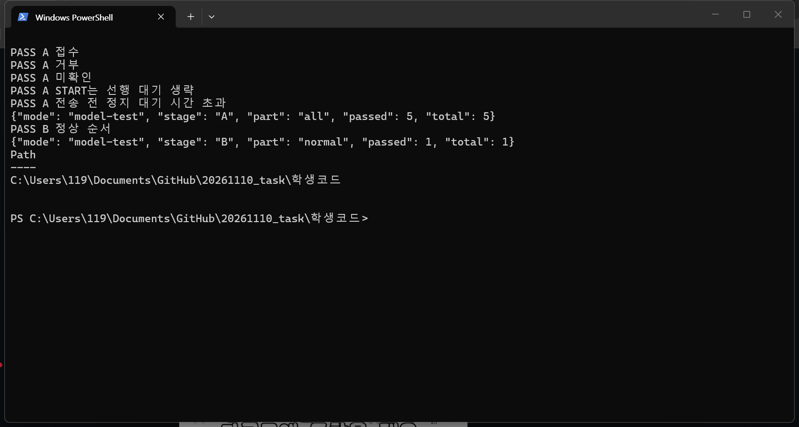

AI를 사용했다면 자신이 먼저 지정한 요청·관측·완료 조건을 적는다. AI의 설명과 실제 결과가 달랐던 경우에는 어떤 관측으로 수정했는지 남긴다. AI가 생성한 코드 전체를 붙이는 것으로 시험 기록을 대신하지 않는다.

## 통합 시험

각 시험 전에 예상 결과를 한 문장으로 적는다. 자동 검사 통과와 별개로 자기 UI의 표시·명령·로그를 대조한다.

| 시험 조건 | 실행 전 예상 | 실제 관측·시각 | 다음 명령 유무 | 통과·실패·미확인 |
| --- | --- | --- | --- | --- |
| 정상 한 사이클 | 1111→9991→정지→닫힘→9992→정지→열림 순으로 완료 | 세 프로그램 가상장치 13:56:38.247 시작 ~ 13:56:49.563 "한 사이클 완료" | 완료 후 추가 명령 없음 | 통과 (가상장치, 실물 미검증) |
| 이동1 중 보통 정지 | 이동1 완료·그리퍼 닫힘까지 진행 후 9994, 이동2 없음 | 가상장치 14:38:24.173 정지 요청(0001 동작 중) → 14:38:26.361 0002 → 14:38:29.417 0005 닫힘 → 14:38:29.621 9994 보냄 → 14:38:29.684 접수, "정지" | 9994만 (9992 없음) | 통과 (가상장치, 실물 미검증) |
| 이동2 중 보통 정지 | 이동2 전송 뒤라 현재 사이클을 끝까지 완료, 9994 없음 | 가상장치 14:38:42.877 9992 보냄 → 14:38:42.945 정지 요청 → 14:38:45.184 0005 → 14:38:48.267 0002 "한 사이클 완료" | 없음 | 통과 (가상장치, 실물 미검증) |
| 이동1 실제 시작 뒤 즉시 정지 후 재개 | DO0 ON·RUN1 ON 확인 후 9995 → robot 비정상 정지 유지, 자동 순서는 이동1 완료 대기 → 9993 재개 뒤 이동1 완료부터 정상 진행 | 가상장치 14:57:48.485 DO0=1·M00414=1·동작 중 → 14:57:48.880 9995 접수, 0003, 로봇 "정지 중" → 6.9초간 9992 없음 → 14:57:55.789 9993 접수, 0001 → 14:57:57.234 0002 → … 14:58:05.891 한 사이클 완료 | 정지 중 없음, 재개 뒤 9992 정상 | 통과 (가상장치, 실물 미검증) |
| 3단계 닫힘 중 정지·재개 | 닫힘은 끝나도(gripper=1) robot≠1이라 9992 보류, 재개로 새 robot=1 관측 뒤 9992 전송 | 가상장치 14:58:18.815 9995 접수(0003) → 14:58:20.856 0006 닫힘 완료(비정상 정지) → 8초간 9992 없음 → 14:58:28.827 9993 접수, 0005 → 14:58:28.827 9992 보냄·접수 → 14:58:34.038 완료 | 재개 뒤에만 9992 | 통과 (가상장치, 실물 미검증) |
| 5단계 열림 중 정지·완료·별도 재개 | 남은 명령이 없으므로 열림 관측으로 "완료", 그러나 robot 비정상 정지는 남음 → 별도 9993으로 해제 | 가상장치 14:58:47.163 9995 접수(0006) → 14:58:49.220 0003(비정상 정지·열림), "한 사이클 완료" → 14:58:55.877 별도 9993 접수, 0002 | 완료 뒤 추가 명령 없음 (9993은 사람이 별도) | 통과 (가상장치, 실물 미검증) |
| 읽기 실패·제한 시간 안 복구 | 짧은 읽기 실패 중에도 마지막 관측은 보존. 회복 후에도 작업 완료는 새 관측으로 따로 판정 | 내부 모형 read_fail: 3.02 9991 접수(0001) → 3.08 읽기 실패(comm_ok=false, 마지막 raw 1 보존) → 3.46 읽기 회복, raw 1(아직 동작 중) | 없음 (writes=[9991]) | 통과 (내부 모형, 가상장치·실물 미검증) |
| 읽기 실패·제한 시간 초과 | 이동1 완료 대기 중 새 관측 없이 제한 시간 초과 → 단계·제한 시간을 남기고 중단, 9992 없음 | 내부 모형 read_timeout: 3.12 9991 접수 → 3.18 읽기 실패 → 3.32 "중단: 2단계 이동1: 시간 초과 (0.2초 …)" → 3.62 읽기 회복 | 없음 (writes=[1111, 9991], 9992 없음). auto_maybe_on=true | 통과 (내부 모형, 가상장치·실물 미검증) |
| 쓰기 응답 유실 | 9991 판정 미확인, 재전송 없음, 다음 명령 없이 중단 | 내부 모형 write_reply_lost: 3.00 미확인, 3.06 0001(실제 전달·동작), 5.25 0002 | 없음 (writes=[9991]) | 통과 (내부 모형, 가상장치·실물 미검증) |
| 중단 후 자동 해제·개별 조작 | 미확인 중단 뒤 개별 세 버튼 보류 → 9994 접수 뒤 허용 → 그리퍼 열기 → 다음 시작 정상 완료 | 내부 모형 UI(lesson_ui) 14:54:13.897 9991 미확인 중단 → 14:54:20 세 버튼 보류 → 14:54:23.633 9994 접수 → 세 버튼 허용 → 14:54:36.383 3333 접수 → 14:54:39.435 0002 → 14:54:40.501 시작 → 14:54:51.627 한 사이클 완료 | 9994 → 3333 → 다음 사이클 1111·9991·9992 | 통과 (내부 모형 UI, 가상장치·실물 미검증) |

## 수정과 재시험

실패한 조건: 9991 쓰기 응답 유실로 자동 순서가 미확인 중단된 뒤(auto_maybe_on=true), 개별 스크립트1·스크립트2·그리퍼 버튼이 허용됨. 예상은 보류였다. 검사 `check_student.py --stage D` FAIL 0/1 ("복구 미확인 상태의 개별 세 버튼을 보류해야 합니다"). 마지막 정상 관측: 수정 전 실행 14:53:48.521 1111 접수 이후, 9991은 14:53:48.723 미확인. 그 뒤 새 관측 14:53:48.925 0001 → 14:53:50.968 0002 → 14:53:54.011 0005(PC 명령 없이 그리퍼 자동 닫힘). 확인된 원인과 근거: `_why_off`의 script1·script2·gripper 조건에 `auto_maybe_on` 검사가 없음. 근거는 14:53:55 화면에서 세 버튼 enabled=true, hint 없음(캡처/D_수정전_복구전.png). 그리퍼 자동 닫힘(0005)으로 PLC 자동 운전이 실제로 켜져 있었음이 확인된다.

바꾼 코드·설정 한 가지: `sequence.py` `_why_off`에 `auto_unknown = (self.auto_maybe_on, "자동 운전 여부 미확정: 자동 운전 해제(9994)를 먼저 하세요")`를 추가하고, script1·script2·gripper 조건 목록에만 넣음(통신·유효 검사, 즉시 정지·해제·재개는 그대로). 같은 조건으로 다시 실행한 명령: 앱 종료 → 수정 → `python -B -X utf8 lesson_ui.py --fault write_reply_lost` 재실행 → 시작(같은 첫 9991 응답 유실 고장). 함께 `python -B -X utf8 check_student.py --stage D` → PASS 1/1. 수정 전후 로그: 수정 전 14:53:55 세 버튼 허용 → 수정 후 14:54:13.897 같은 미확인 중단, 14:54:20 세 버튼 보류("자동 운전 여부 미확정…") → 같은 실행에서 14:54:23.633 9994 접수 → 세 버튼 허용 → 14:54:36 3333으로 열기 → 14:54:51.627 다음 사이클 완료. 캡처: D_수정전_복구전 / D_수정후_복구전 / D_수정후_9994후 / D_수정후_다음실행. 앱 재실행은 수정 반영을 위한 새 시험 시작이며, 복구 판단은 수정 후 같은 실행 안의 9994 접수로만 했다.

아직 확인하지 못한 조건: ① D 정책을 세 프로그램 가상장치에서 확인하지 않았다(내부 모형 UI에서만). ② 실물(XG5000 PLC·HCR 로봇·그리퍼)에서는 어떤 시험도 하지 않았다. ③ 읽기 실패·쓰기 응답 유실을 가상장치·실물 통신에서 재현하지 않았다. 다음 확인 방법: 실물 연결 후 첫 관측부터 같은 표로 다시 기록하고, 정상 → 정지 경계 → 즉시 정지·재개 → 거부 순서로 같은 조건을 재시험한다. 통신 고장은 케이블 분리 등 실물 조건으로 강사 확인 하에 시험한다.

## 제출

실행 가능한 자기 코드, 실행 명령과 설정, 위 시험 기록, 필요한 로그·화면, 미확인 조건을 묶어 제출한다. 컴퓨터의 COM 번호를 다른 학생의 번호로 바꾸지 않고 자신이 확인한 값을 기록한다. 내부 모형·세 프로그램 가상장치·실물 성공을 나눠 쓴다.

## 세 프로그램 가상장치 연결 기록

실행 순서는 [가상장치실습안내](../가상장치실습안내.md)를 따른다. 세 터미널은 같은 학생코드 폴더에서 연다. Python 수정 후 PC 재실행, 로봇 파일 수정 후 파일 재선택을 구분한다.

| 항목 | 실제 사용한 값·시각 |
|---|---|
| 터미널 1·2·3의 Get-Location | 세 프로그램 모두 `C:\Users\119\Documents\GitHub\20261110_task\학생코드` (백그라운드 실행, 같은 cwd) |
| PLC 명령·래더 파일·RUN 시작 시각 | `python -B -X utf8 -m fake_plc ladder/PICKNPLACE_FULL.xgwx --modbus-port 5020 --wiring-port 5021 --http-port 8878` / PICKNPLACE_FULL.xgwx / 약 13:56:1x 시작 (PC 첫 상태 13:56:14.274) |
| PLC Modbus 5020·배선 5021·화면 8878 | 5020·5021 설정, 8878 HTTP 200 응답 확인 |
| 로봇 실행 명령·화면 8879 | `python -B -X utf8 -m fake_robot --plc-host 127.0.0.1 --wiring-port 5021 --http-port 8879` / 8879 HTTP 200 |
| 로봇 모드: 내장 / 파일, 선택 파일명·다시 선택한 시각 | B-1~통합 시험(~14:59)은 내장 스크립트. 15:07:23 파일 모드로 전환: 학생코드 `robot/PICKNPLACE_FULL_main.js` 선택(사용자가 8879에서 직접 선택. 화면 파일명 표시: 실행 중 스크립트 "PICKNPLACE_FULL_main.js"(멈춤 버튼 옆). 파일 입력칸은 읽은 뒤 "선택된 파일 없음"으로 돌아감. 캡처/USER_로봇_파일모드.png), 로봇 로그 "실행 시작 / 스레드1 시작", 경고 2건(DI_STOP·POLL_MS 변수 공유 실물 미확인). 다시 선택: 없음 |
| PC 실행 명령·대상 tcp:127.0.0.1:5020·화면 8877 | `python -B -X utf8 -m picknplace_full --target tcp:127.0.0.1:5020 --http-port 8877` / `/api/status` target = `127.0.0.1:5020`, comm_ok = true → 자기 sequence.py 연결 확인 |
| 내가 수정한 sequence.py의 저장·PC 재실행 시각 | D 수정 저장 후 PC 앱 최초 실행(2026-11-10 13:56경) |
| 기본 시험 전 강제 입력이 해제돼 있는지 | 강제 입력 조작 없음. 시작 전 PC 상태 0002 (정지·열림·정상) |

## 준비·요청·응답의 연결

| 확인할 장면 | 제공 구현의 예상 | 실제 관측·시각·근거 |
|---|---|---|
| PLC RUN 첫 약 3초 | 0002·시작 버튼 활성이어도 M00418 열기 준비가 남아 명령 거부 가능 | 14:59:14.704 PLC STOP→RUN, M00418=1 · T0300 진행 중. +5ms PC 0002·시작 활성 → 14:59:14.757 1111 보냄 → 14:59:14.822 **거부**, 0008(이상), "중단: 1단계 자동 운전 시작: 1111 거부", auto_maybe_on=true → 14:59:29.067 9994 접수로 0002 복귀. 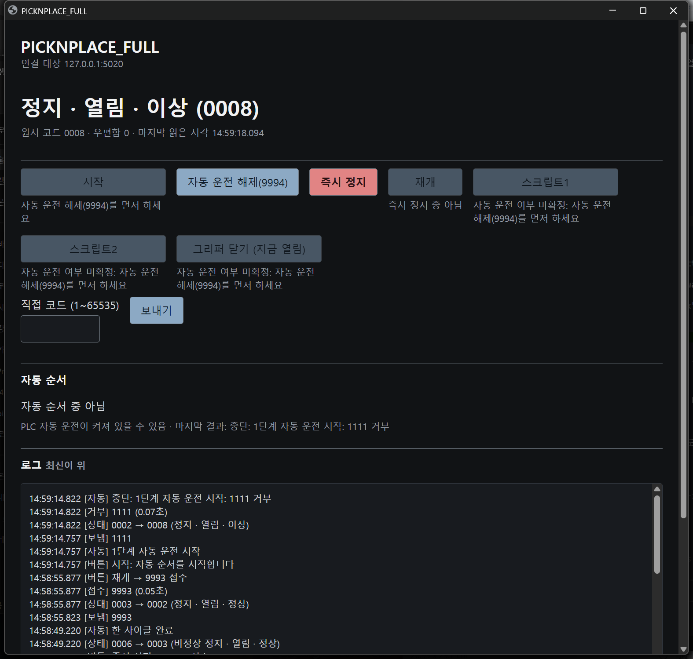 |
| 이동1 요청 9991 | P00044 → DI0 → DO0 → P00004 → D01000 → PC 새 관측 | 14:57:48.201 PC 9991 보냄 → 14:57:48.237 P00044=1·로봇 DI0=1·D01000=1 → 14:57:48.262 PC 접수·새 관측 0001 → 14:57:48.424 로봇 DO0=1(DI0 해제) → 14:57:48.485 P00004=1·M00414=1·P00044=0 → 14:57:57.223 DO0=0·P00004=0·M00414=0·D01000=2 → 14:57:57.234 PC 0002 |
| 즉시 정지 요청 직전 | 0001만으로 출발 확정 불가. 로봇 DO0 ON·움직임과 해당 PLC RUN1 또는 RUN2 ON을 함께 확인 | PC 0001은 14:57:48.262부터였으나 DO0=1은 14:57:48.424, M00414=1은 14:57:48.485 (약 0.22초 늦음). 셋 모두 확인 뒤 14:57:48.880 9995 |
| 이동1 PLC 시작 확인 | RUN1(M00414) ON. PLC 운전 모드 RUN과 다른 내부 비트 | 14:57:48.485 M00414=1 (P00004=1과 함께). 이동 끝 14:57:57.223에 0 |
| 이동2 PLC 시작 확인 | RUN2(M00415) ON. 해당 이동을 PLC가 시작으로 확인한 근거 | 14:58:00.533 P00045=1·DI1=1 → 14:58:00.781 DO0=1·P00004=1·M00415=1 → 14:58:02.780 M00415=0 |
| 목표 도착, PLC 요청이 남음 | DO0 유지. 요청 OFF 확인 후 DO0 OFF | |
| 3단계 닫힘 중 정지 | 닫힘 후에도 9992 보류. 재개로 새 robot=1을 본 뒤 전송 | 14:58:18.815 9995 → 14:58:20.856 0006(닫힘·비정상 정지), 단계 표시는 "4단계 이동2"지만 9992 미전송(전송 전 정지 대기 중) → 14:58:28.827 9993 접수 0005 → 같은 시각 9992 전송·접수 |
| 5단계 열림 중 정지 | 열림 후 작업 완료 가능. 재개가 없으면 robot=2 유지 | 14:58:47.163 9995 → 14:58:49.220 0003(비정상 정지·열림), "한 사이클 완료", 이후 6.6초간 0003 유지(로봇 "정지 중", DO1=1, M00411=1) |
| 5단계 완료 뒤 9993 | 작업 완료와 별도로 기능 정지 해제 확인 | 14:58:55.877 9993 접수 → 0002, M00411=0, 로봇 DO=00 "쉼" |

세 화면 정지 시험의 별도 기록: 로봇 DO0 ON 관측 시각 14:57:48.424 / PLC RUN1 또는 RUN2 ON 관측 시각 14:57:48.485 (RUN1, M00414) / 실제 움직임 확인 로봇 상태 "동작 중" 14:57:48.237부터 / 즉시 정지 입력 시각 14:57:48.880 (9995 접수).

내부 모형 `lesson_scenarios.py --case pause`는 제공 코드가 입력 시점을 통제한 독립 사례다. 그 출력만 얻었다면 위 세 화면의 PLC 시작 확인 칸은 직접 관측하지 않았다고 적는다.

위 표의 예상은 실제 결과를 대신하지 않는다. 화면이 너무 빨리 바뀌어 보지 못했다면 미확인이라고 쓴다. 초기 준비·정지 시점이 달랐는지 비교한 뒤 같은 조건으로 재시험한다.

PC 재시작·PLC STOP/RUN·파일 다시 열기·로봇 파일 재선택을 했다면 언제 왜 했는지 적는다: ① 14:5x PC 앱 재시작: D 시험용 lesson_ui(8877)를 쓰기 위해 종료했다가, 통합 시험을 위해 tcp:127.0.0.1:5020으로 다시 실행. ② 14:59:14.704 PLC STOP→RUN: RUN 직후 3초 안의 시작 거부를 재현하기 위해.

그 조작으로 새로운 시험을 시작했는가, 같은 작업에서 명령 접수를 확인하며 복구했는가: 두 조작 모두 **새로운 시험의 시작**이다. 거부 뒤 상태는 같은 PC 실행 안에서 9994 접수로 복구했다. 근거: 14:59:14.822 1111 거부, auto_maybe_on=true, 0008 → 14:59:29.067 9994 접수 → 0002·auto_maybe_on=false.

5단계 결과 확인에 내부 모형 `lesson_scenarios.py --case final_open_estop`를 썼다면 `result`, `resume_sent`, `robot_abnormal_remains`를 적는다: 내부 모형 `python -B -X utf8 lesson_scenarios.py --case final_open_estop`의 결과는 `result`="완료", `resume_sent`=false, `robot_abnormal_remains`=true다. task_complete_is_not_stop_released=true, writes=[1111, 9991, 9992, 9995], 최종 raw 3 (robot=2). 10.62에 9995 접수, 13.61에 0006 → 0003이 되고 "한 사이클 완료"가 나왔다. (세 프로그램 결과는 위 "5단계 열림 중 정지" 줄: 14:58:49.220 0003·완료, 14:58:55.877 별도 9993.) 세 프로그램에서 관측한 결과와 별도 줄로 기록한다.

## B-1 정상 한 사이클 로그 (세 프로그램 가상장치, 2026-11-10)

PC `/api/status`의 events:
```
13:56:38.247 버튼 시작: 자동 순서를 시작합니다
13:56:38.248 자동 1단계 자동 운전 시작
13:56:38.248 보냄 1111                        ← 요청 ①
13:56:38.314 접수 1111 (0.07초)
13:56:38.315 자동 2단계 이동1
13:56:38.531 보냄 9991                        ← 요청 ② (전송 전 정지 관측 후)
13:56:38.594 상태 0002 → 0001 (동작 중 · 열림 · 정상)
13:56:38.594 접수 9991 (0.06초)
13:56:40.857 상태 0001 → 0002 (정지 · 열림 · 정상)   ← 완료 대기 ① 이동1 정지
13:56:40.857 자동 3단계 그리퍼 닫힘 기다림
13:56:43.944 상태 0002 → 0005 (정지 · 닫힘 · 정상)   ← 완료 대기 ② 그리퍼 닫힘
13:56:43.952 자동 4단계 이동2
13:56:44.161 보냄 9992                        ← 요청 ③
13:56:44.223 상태 0005 → 0004 (동작 중 · 닫힘 · 정상)
13:56:44.223 접수 9992 (0.06초)
13:56:46.482 상태 0004 → 0005 (정지 · 닫힘 · 정상)   ← 완료 대기 ③ 이동2 정지
13:56:46.482 자동 5단계 그리퍼 열림 기다림
13:56:49.563 상태 0005 → 0002 (정지 · 열림 · 정상)   ← 완료 대기 ④ 그리퍼 열림
13:56:49.563 자동 한 사이클 완료
```

- 요청 3개: 1111(자동 운전 시작), 9991(이동1), 9992(이동2). 3333은 보내지 않았고, 그리퍼 전환은 PLC가 했다.
- 완료 대기 4개: 이동1 정지(robot==1), 그리퍼 닫힘(gripper==1), 이동2 정지(robot==1), 그리퍼 열림(gripper==0).
- UI 단계 표시: 8877 화면의 "자동 순서" 칸이 1단계 → 2단계 이동1 → 3단계 그리퍼 닫힘 기다림 → 4단계 이동2 → 5단계 그리퍼 열림 기다림 → "자동 순서 중 아님 / 마지막 결과: 완료" 순으로 바뀌는 것을 화면 캡처로 확인했다(14:22:22~14:22:34 재실행 사이클, 아래 캡처).
- 접수만 받고 넘어가면 생기는 충돌: 9991이 접수된 13:56:38.594는 로봇이 막 움직이기 시작한 때(0001)다. 여기서 바로 닫힘 대기나 9992로 넘어가면 다음 문제가 생긴다.
  - 집기 위치에 도착하기 전에 PLC 그리퍼 닫힘과 이동2 요청이 겹친다.
  - 동작 중인 로봇에 9992를 보내 거부되거나, 물건을 잡지 못한 채(열림) 놓기 위치로 이동한다.
  - 이동2 뒤 열림을 확인하지 않으면, 그리퍼가 닫힌 채 다음 사이클 START 조건("그리퍼를 먼저 여세요")과 충돌한다.

### B-1 화면 캡처 (세 프로그램 가상장치, 2026-11-10 14:22 재실행 사이클)

13:56 사이클과 같은 조건(같은 세 프로그램, 같은 sequence.py)에서 화면 캡처용으로 한 번 더 실행했다. 14:22:22.966 시작 → 14:22:34.047 "한 사이클 완료".

| 장면 | 캡처 |
|---|---|
| A·B-1 함수 검사 (터미널, 학생코드 폴더) |  |
| PLC 8878: PICKNPLACE_FULL.xgwx, RUN, 로봇 1대 연결됨 | 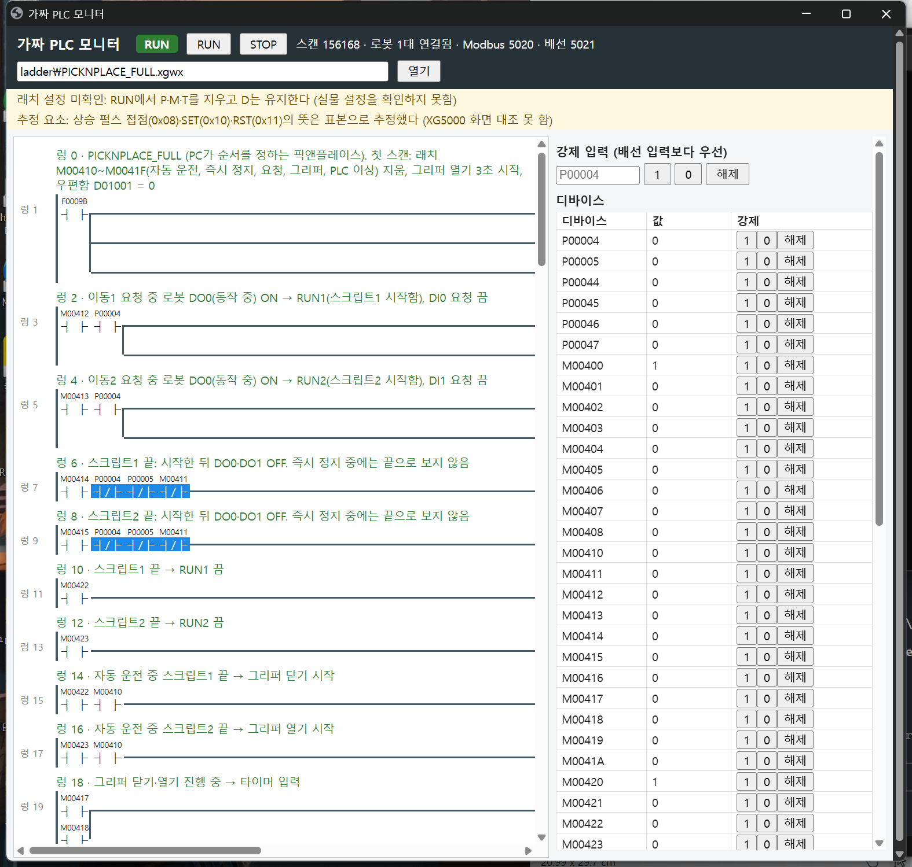 |
| 로봇 8879: 내장 스크립트 모드 | 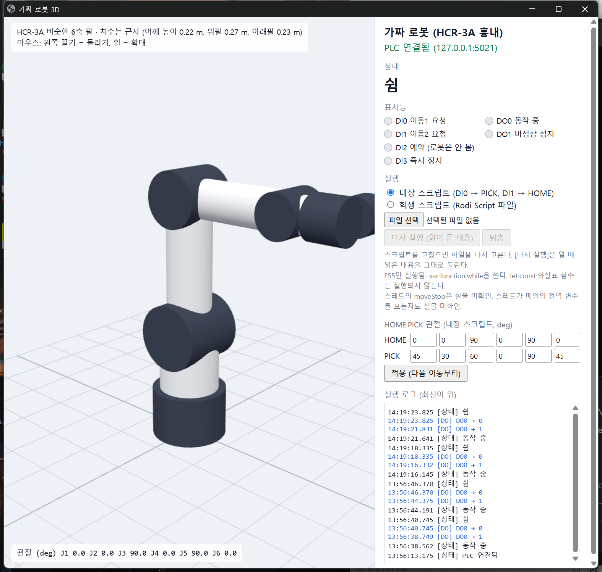 |
| PC 8877 시작 전: 연결 대상 127.0.0.1:5020, 0002 |  |
| 1단계 자동 운전 시작 | 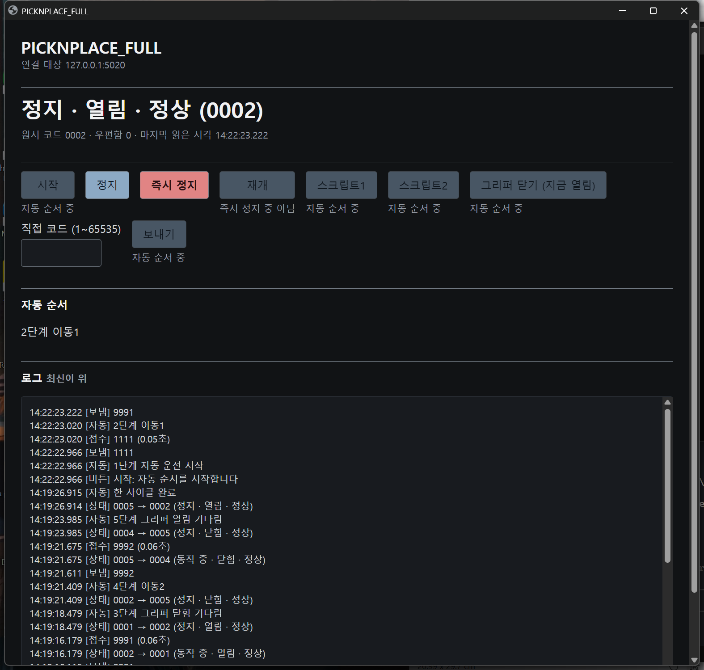 |
| 2단계 이동1 (0001 동작 중) | 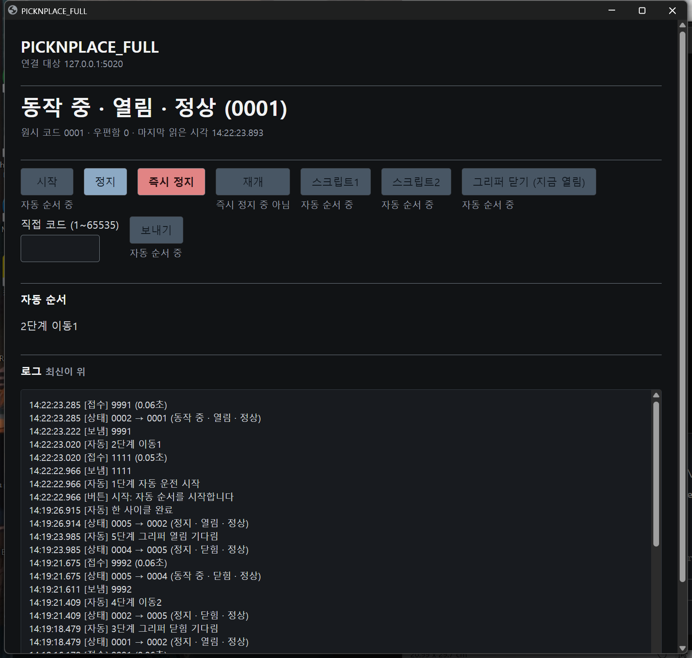 |
| 3단계 그리퍼 닫힘 기다림 | 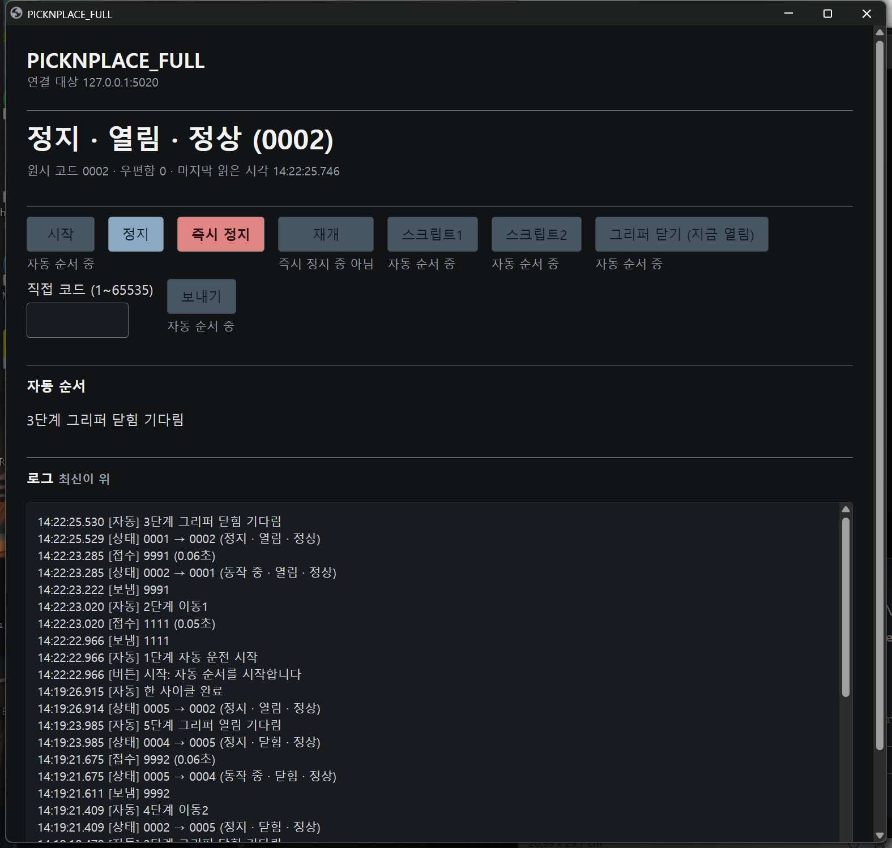 |
| 4단계 이동2 | 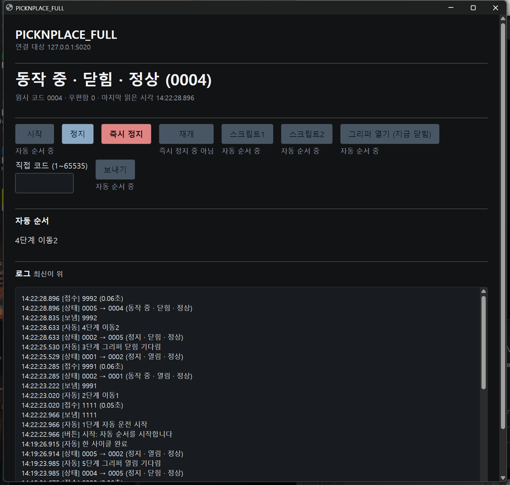 |
| 5단계 그리퍼 열림 기다림 | 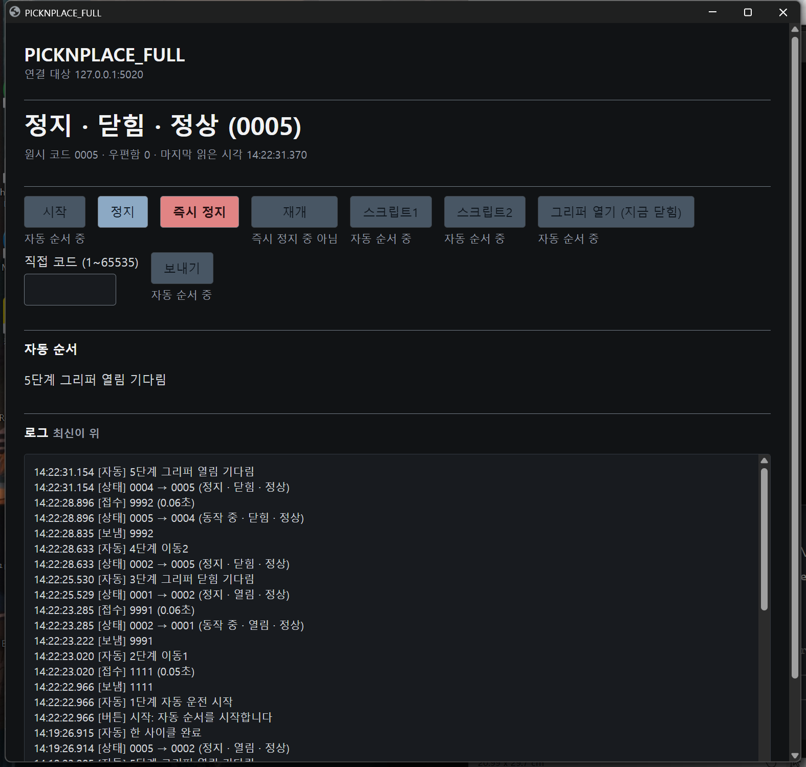 |
| 완료: 자동 순서 중 아님 / 마지막 결과: 완료 (0002) |  |

## B-2 정지 경계 (2026-11-10)

함수 검사 (내부 모형):
```
PASS B 정지 after_start
PASS B 정지 after_move1
PASS B 정지 after_move2
{"mode": "model-test", "stage": "B", "part": "stop", "passed": 3, "total": 3}
```

세 프로그램 가상장치에서 PC 8877의 정지 버튼을 각 시점에 눌러 시험했다.

| 정지 요청 시점 | 예상 다음 동작 | 실행 근거 기록 |
|---|---|---|
| 1111 접수 뒤, 이동1 전 | 1111 접수 직후 경계 ①에서 정지 처리. 9991을 보내지 않고 9994 → "정지" | 14:38:19.051 1111 보냄 → 14:38:19.060 정지 요청 → 14:38:19.109 1111 접수 → "자동 운전 해제" → 14:38:19.314 9994 보냄 → 14:38:19.375 접수, "정지". 9991 없음. 로봇 0002 그대로. 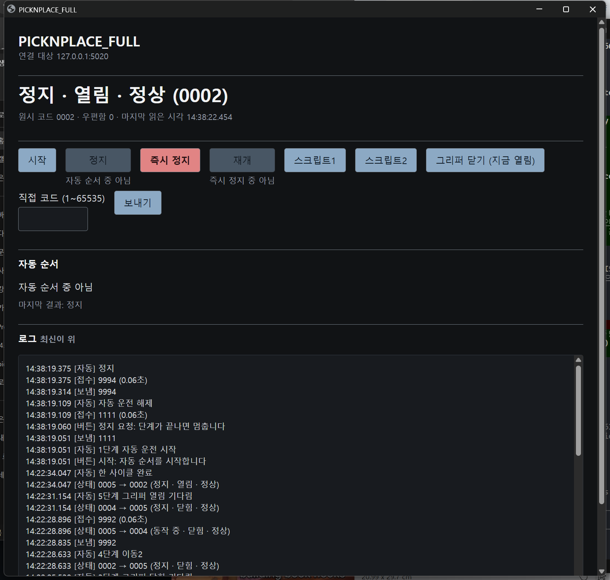 |
| 이동1 중 | 이동1은 멈추지 않는다(보통 정지는 로봇 정지 신호가 아님). 이동1 완료 → PLC 그리퍼 닫힘 확인 → 경계 ②에서 9994 → "정지". 9992 없음 | 14:38:24.091 9991 접수(0001) → 14:38:24.173 정지 요청 → 14:38:26.361 0002 → 14:38:29.417 0005 닫힘 → 14:38:29.621 9994 보냄 → 14:38:29.684 접수, "정지". 9992 없음. 물건을 잡은 채(닫힘) 정지 → 다음 시작은 "그리퍼를 먼저 여세요"로 막힘 → 14:38:32.818 3333(개별 그리퍼)으로 열고 다음 시험 진행. 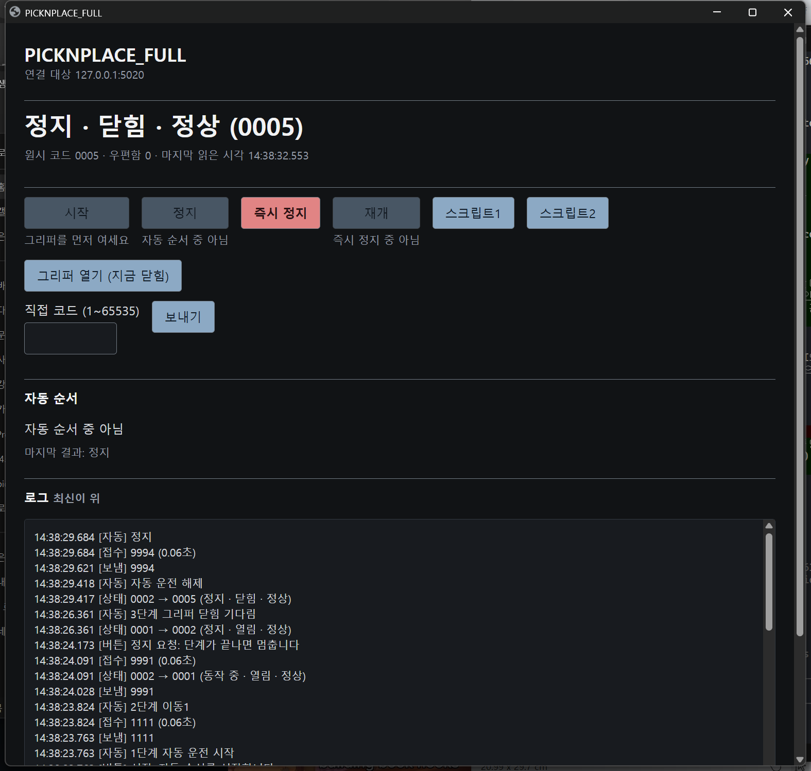 |
| 이동2 시작 뒤 | 이동2를 보낸 뒤에는 경계가 없으므로 이동2 완료 → 그리퍼 열림까지 마치고 "완료". 9994 없음 | 14:38:42.877 9992 보냄 → 14:38:42.939 접수(0004) → 14:38:42.945 정지 요청 → 14:38:45.184 0005 → 14:38:48.267 0002, "한 사이클 완료". 9994 없음. 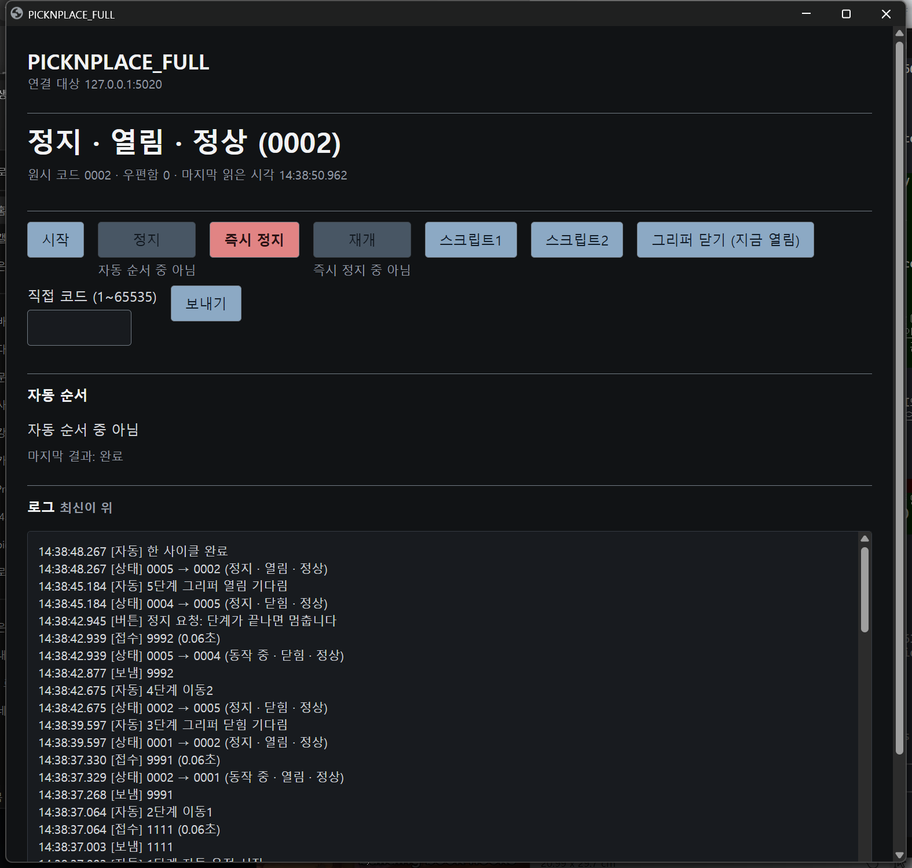 |

- `stop_requested`는 PC가 요청을 기억하는 변수이며 로봇에 보내는 정지 신호가 아니다. 그래서 이동 중에 눌러도 로봇은 그 이동을 끝낸다. 동작을 바로 멈추려면 즉시 정지를 쓴다.
- 1111 접수 뒤 경계는 사람이 버튼으로 맞추기 어렵다(1111 접수까지 0.06초). 이 시험에서는 시작 직후 9ms 만에 정지를 눌러 1111 접수 전에 요청이 기억되게 했고, 경계 ①에서 처리됐다.
- 이동1 중 정지 사례에서 3333으로 그리퍼를 연 것은 다음 시험 준비를 위한 개별 조작이다. 같은 작업을 복구한 것이 아니다.

## C 새 관측과 시간 제한 (내부 모형, 2026-11-10)

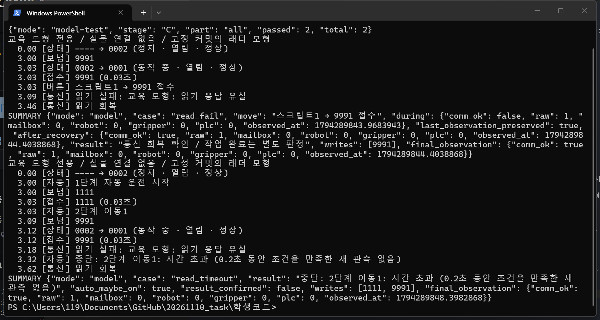

함수 검사: `PASS C fresh`, `PASS C timeout` → 2/2. 위 캡처 상단의 JSON은 화면 위로 밀린 PASS 줄의 요약이다.

| 항목 | read_fail (짧은 실패 후 회복) | read_timeout (자동 순서 대기 제한 초과) |
|---|---|---|
| 요청 | 개별 스크립트1 9991 (3.02 접수) | 자동 1111 → 9991 (3.12 접수) |
| 읽기 실패 | 3.08, comm_ok=false. 마지막 관측(raw 1, 동작 중)은 보존 | 3.18 |
| 판정 | 3.46 회복. result="통신 회복 확인 / 작업 완료는 별도 판정" | 3.32 "중단: 2단계 이동1: 시간 초과 (0.2초 동안 조건을 만족한 새 관측 없음)" |
| writes | [9991] | [1111, 9991]. **이동2(9992) 없음** |
| 회복 뒤 상태 | raw 1 (아직 동작 중) | 3.62 회복, raw 1 (동작 중), auto_maybe_on=true, result_confirmed=false |

- 시간 초과 뒤 9992가 없는 것은, `_until`이 `Abort`를 올려 `_cycle`의 다음 줄(4단계)까지 가지 않았기 때문이다.
- 통신이 회복된 것은 "다시 읽을 수 있다"는 뜻일 뿐, 작업이 완료됐다는 뜻은 아니다. 두 사례 모두 회복 직후 관측이 raw 1(동작 중)이었다.
  - 이동1 완료(robot==1)를 제한 시간 안에 새 관측으로 보지 못했으므로, 그 사이에 무슨 일이 있었는지 확정할 수 없다.
  - 화면에 남은 마지막 정상 상태는 실패 전 값이므로 현재 통신 성공의 근거가 아니다.
  - 그래서 회복 뒤 자동으로 이어 가지 않는다. `auto_maybe_on=true`로 남아 9994 해제 후 다시 시작해야 한다(D와 연결).

## D 복구 전 개별 버튼 (내부 모형 UI, 2026-11-10)

실행: `python -B -X utf8 lesson_ui.py --fault write_reply_lost` (코드실행안내 5절 절차. 연결 대상 model, 첫 9991의 쓰기 응답만 한 번 유실)

| 장면 | 시각 | 상태 | 스크립트1 / 스크립트2 / 그리퍼 | 해제 버튼 | 캡처 |
|---|---|---|---|---|---|
| **수정 전** (D 미완성, 검사 0/1) 미확인 중단 후 | 14:53:55 | 0005 정지·닫힘, auto_maybe_on=true | **허용 / 허용 / 허용** (hint 없음) | "자동 운전 해제(9994)" 허용 | 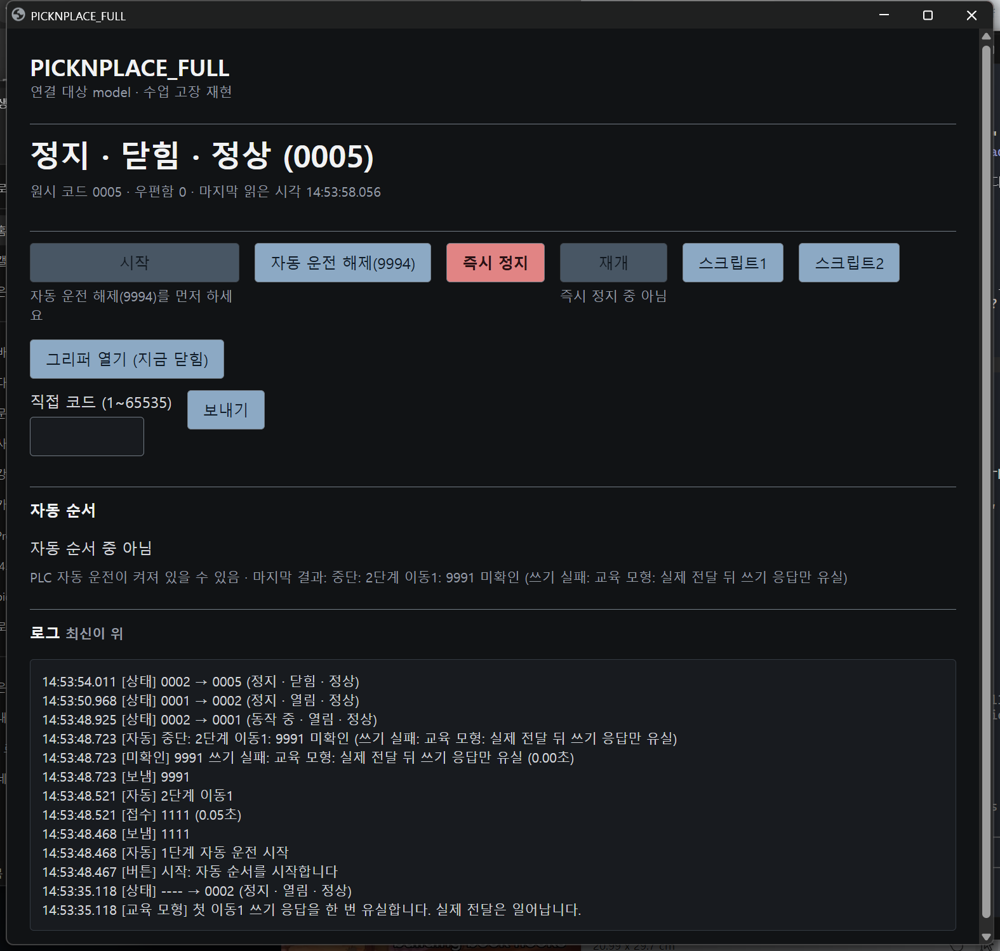 |
| **수정 후** (D 완성, 검사 1/1) 같은 고장 조건 재실행 | 14:54:20 | 0005 정지·닫힘, auto_maybe_on=true | **보류 / 보류 / 보류** ("자동 운전 여부 미확정: 자동 운전 해제(9994)를 먼저 하세요") | "자동 운전 해제(9994)" 허용 | 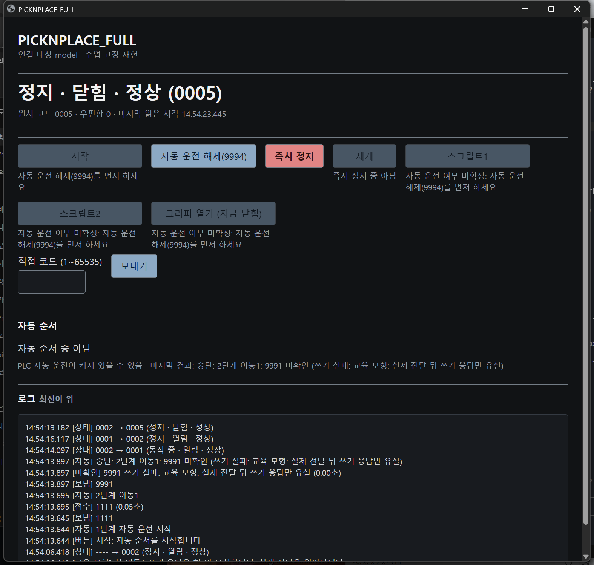 |
| **수정 후, 같은 실행에서 9994 접수 뒤** | 14:54:23.633 접수 | 0005 정지·닫힘, auto_maybe_on=false | **허용 / 허용 / 허용** | "정지"(자동 순서 중 아님)로 복귀 | 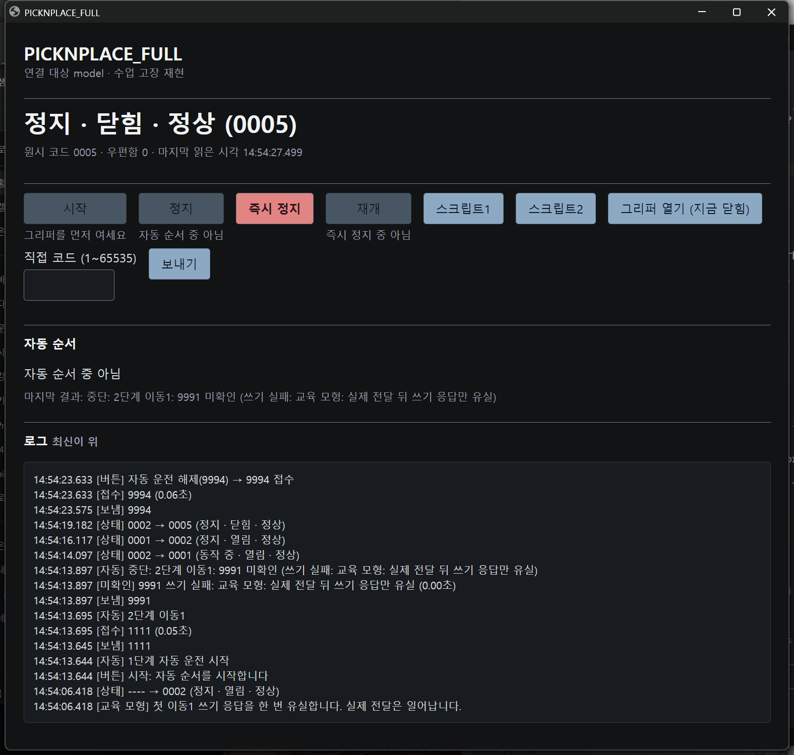 |
| 같은 실행에서 그리퍼 열기 → 다음 시작 | 14:54:36 ~ 14:54:51 | 3333 접수 → 0002 → 한 사이클 완료 | - | - |  |

수정 전후 공통 로그 (수정 후 실행 기준):
```
14:54:13.897 [보냄] 9991
14:54:13.897 [미확인] 9991 쓰기 실패: 교육 모형: 실제 전달 뒤 쓰기 응답만 유실 (0.00초)
14:54:13.897 [자동] 중단: 2단계 이동1: 9991 미확인 (쓰기 실패: …)
14:54:14.097 [상태] 0002 → 0001 (동작 중 · 열림 · 정상)    ← 실제로는 전달되어 이동
14:54:16.117 [상태] 0001 → 0002 (정지 · 열림 · 정상)
14:54:19.182 [상태] 0002 → 0005 (정지 · 닫힘 · 정상)    ← PLC 자동 운전이 켜져 있어 그리퍼 자동 닫힘
14:54:23.575 [보냄] 9994
14:54:23.633 [접수] 9994 (0.06초)                         ← 복구 추정 해제
```

- 미확인 중단 뒤에도 PLC 자동 운전은 실제로 켜져 있었다. 그 근거로 PC가 3333을 보내지 않았는데 그리퍼가 자동으로 닫혔다(0005).
- 이 상태에서 개별 이동·그리퍼를 허용하면 PLC 자동 운전의 그리퍼 전환과 겹칠 수 있다. 그래서 9994 접수로 자동 운전 해제를 확인하기 전까지 보류한다.
- 수정 전 실행은 소스를 수정하기 전에 화면·로그로 기록하고 종료했다. 이후 D를 복원하고 PC 앱을 다시 실행해 같은 고장 조건을 다시 만들었다. 9994 전후 변화는 **수정 후 같은 실행 안에서** 확인했다. 앱 재실행으로 초기화된 상태를 복구 성공으로 쓰지 않았다.
- 수정 전 상태는 `sequence.py`의 세 버튼 조건에서 `auto_unknown`만 잠시 빼서 재현했다. 시험 뒤 D 완성본으로 복원했다(검사 1/1 재확인).

## 즉시 정지·재개 통합 시험 (세 프로그램 가상장치, 2026-11-10 14:57~14:59)

PC·PLC·로봇 상태를 약 50ms 간격으로 함께 읽어 바뀐 줄만 남겼다. 아래는 핵심 줄만 옮긴 것이다.

### 이동1 실제 시작 뒤 즉시 정지 → 재개
```
14:57:48.237 PLC P00044=1 D01000=1 | 로봇 DI=1000 동작 중
14:57:48.424 로봇 DO=10 (DO0 ON)
14:57:48.485 PLC P00004=1 M00414=1(RUN1)       ← 세 조건 확인
14:57:48.880 >>> 즉시 정지 9995 접수 → PC 0003 비정상 정지, M00411=1, 로봇 DI3=1 "정지 중"
14:57:55.789 >>> 재개 9993 접수 → 0001, M00411=0, 로봇 동작 중
14:57:57.234 0002 → 3단계 … 14:58:05.891 한 사이클 완료
```
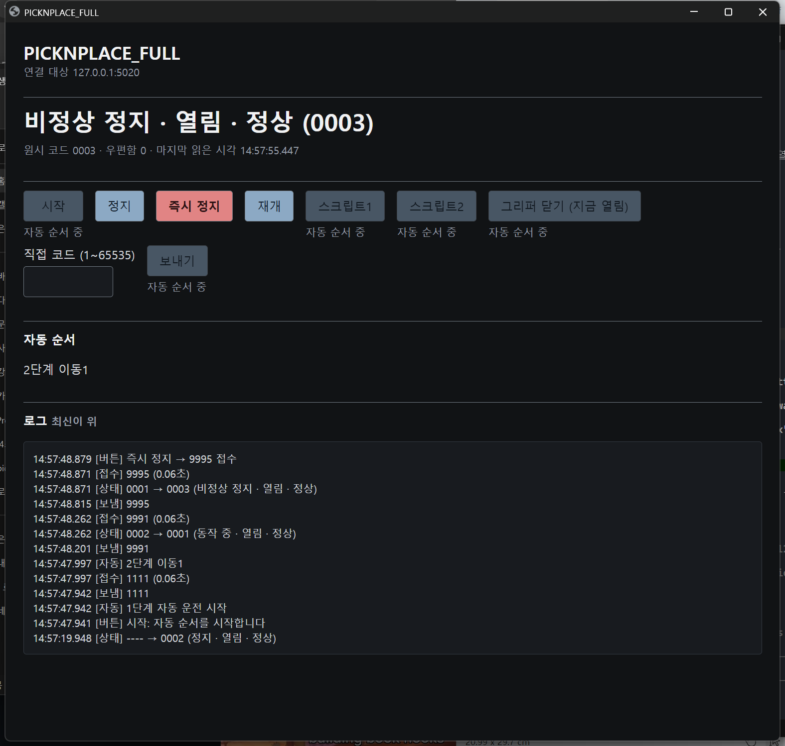 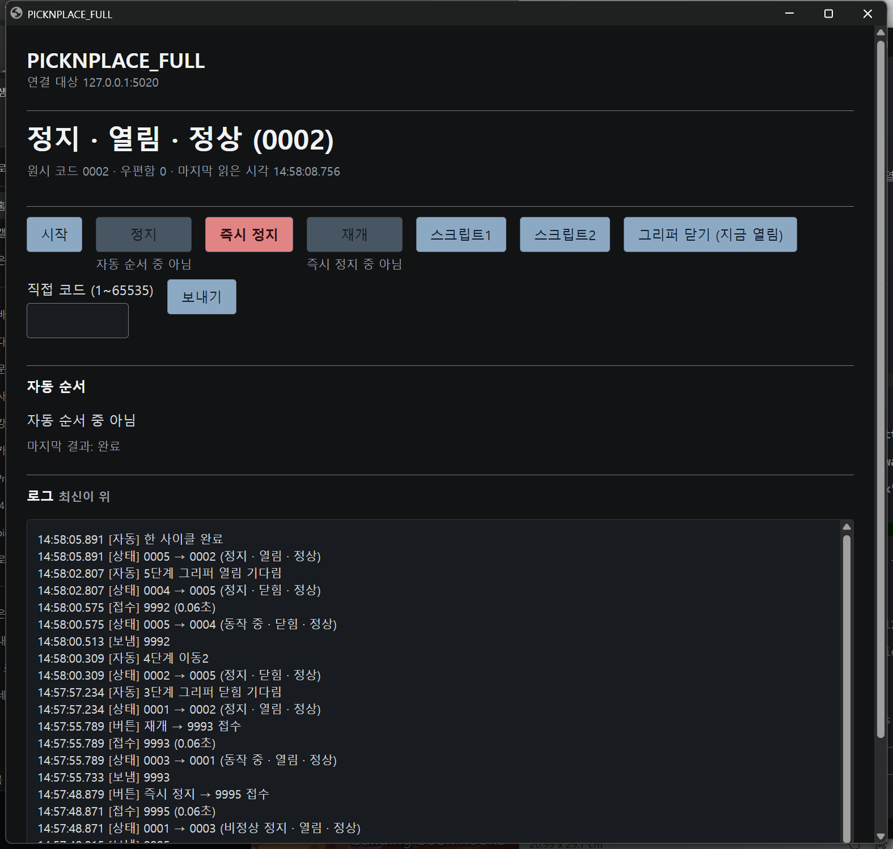

### 3단계 닫힘 중 즉시 정지 → 재개
```
14:58:18.815 9995 접수 → 0003
14:58:20.856 0006 (비정상 정지 · 닫힘)  ← 닫힘은 완료. _cycle은 4단계로 넘어가 _accept(9992)의 전송 전 정지 대기 중
             (14:58:28까지 9992 없음)
14:58:28.827 9993 접수 → 0005 (정지·닫힘) → 같은 시각 9992 보냄
14:58:28.889 9992 접수 → 이동2 → 14:58:34.038 한 사이클 완료
```
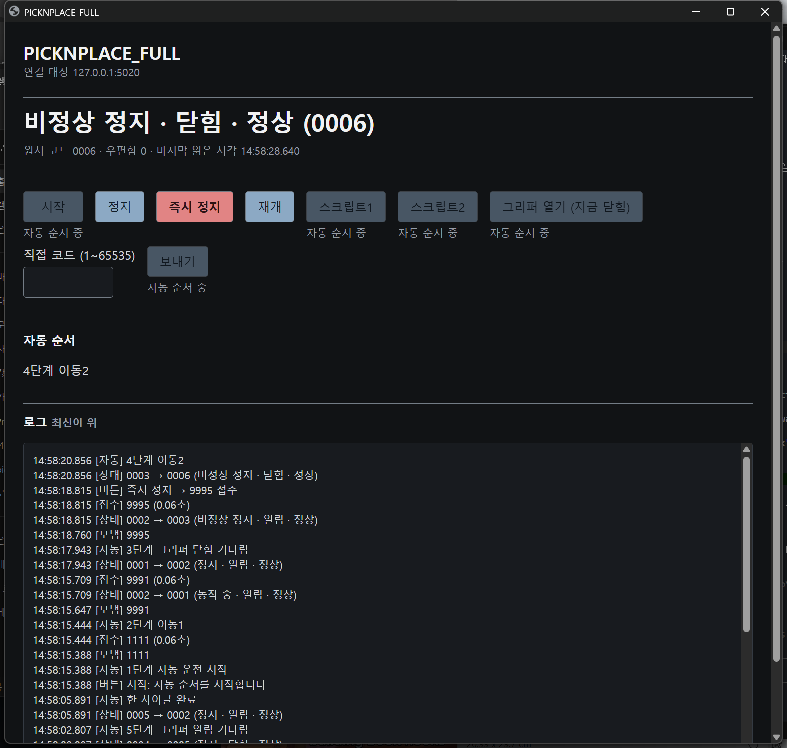 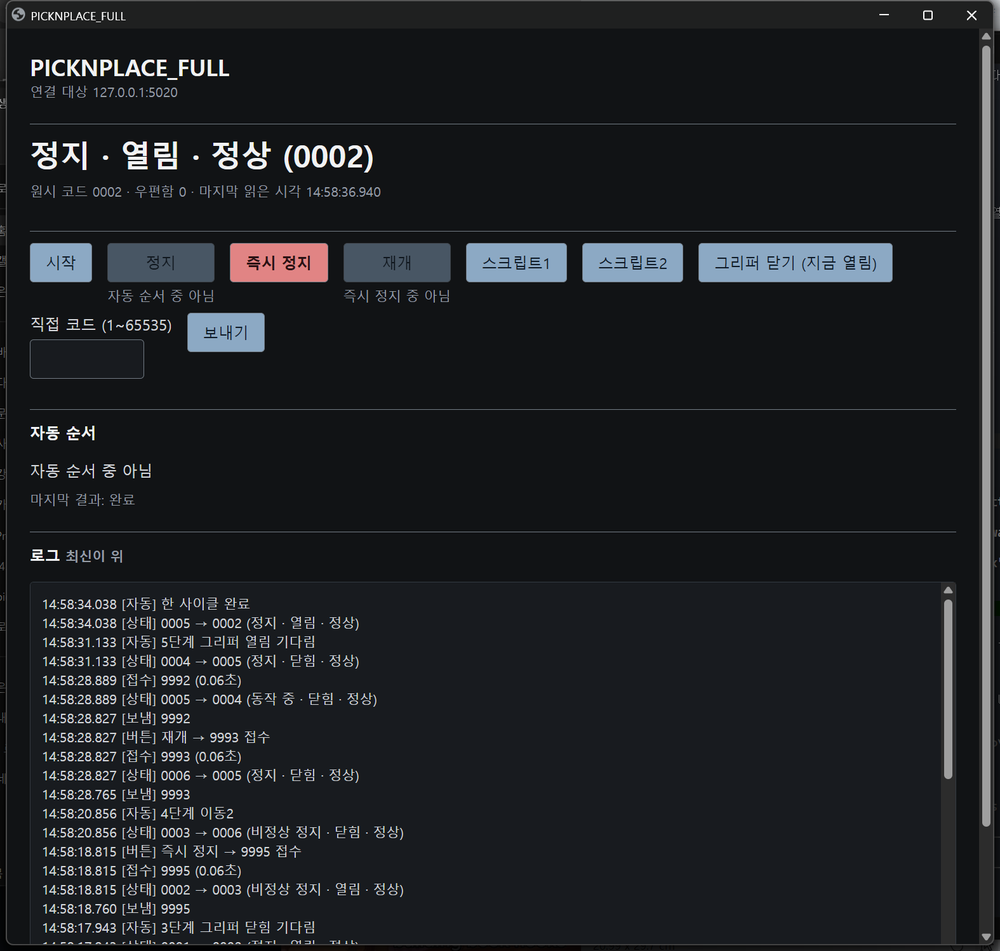

### 5단계 열림 중 즉시 정지 (재개 없이 완료)
```
14:58:47.163 9995 접수 → 0006
14:58:49.220 0003 (비정상 정지 · 열림) → "한 사이클 완료"   ← robot 비정상 정지 그대로 남음
14:58:55.877 별도 9993 접수 → 0002
```
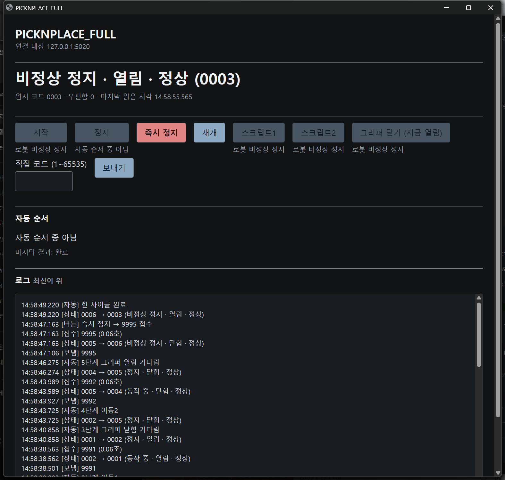 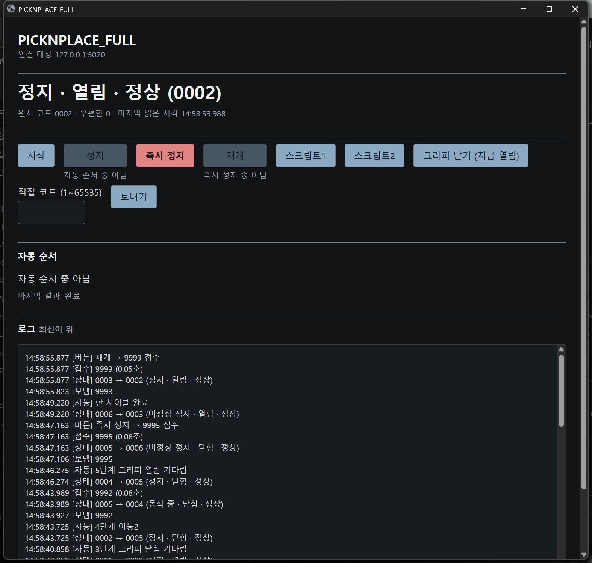

- **3단계와 5단계의 결과가 다른 이유는 다음 명령의 유무다.**
  - 3단계 뒤에는 보낼 명령 9992가 남아 있다. A의 규칙대로 전송 전에 robot==1인 새 관측을 기다리므로, 닫힘이 끝나도 재개 전까지는 보내지 않는다.
  - 5단계는 마지막 단계다. 열림 관측(gripper==0)만 기다리면 끝나고 남은 명령이 없다. 그래서 robot이 비정상 정지인 채로 "완료"가 되고, 기능 정지 해제(9993)는 따로 해야 한다.
- 이 표에서 PC의 robot "비정상 정지"는 원시값 0003/0006으로 나타난다(과제 문서의 robot=2).

### RUN 직후 시작 거부
```
14:59:14.704 PLC STOP→RUN, M00418=1 (그리퍼 열기 준비 타이머 T0300 진행)
14:59:14.709 PC 0002, 시작 버튼 활성
14:59:14.757 1111 보냄 → 14:59:14.822 0008 (정지·열림·이상), [거부] 1111
             중단: 1단계 자동 운전 시작: 1111 거부 (9991 없음), auto_maybe_on=true
14:59:29.067 9994 접수 → 0002
```


- 0002와 시작 버튼 활성만으로는 시작 접수가 보장되지 않는다. PLC 안의 열기 준비(M00418)는 PC 상태 코드에 드러나지 않기 때문이다. 접수 판정을 보고 나서 진행하는 A의 규칙 덕분에 9991이 나가지 않았다.

## 로봇 파일 모드 정상 한 사이클 (세 프로그램 가상장치, 2026-11-10 15:08)

로봇 8879의 모드는 `script`(학생 스크립트)이고, 파일은 `robot/PICKNPLACE_FULL_main.js`를 썼다. 15:07:23.873에 실행이 시작됐고 스레드1이 시작됐다. 경고: "변수 공유는 실물 미확인: DI_STOP / POLL_MS".

```
15:08:01.252 PC 1단계 → 15:08:01.327 2단계 이동1
15:08:01.560 P00044=1 → 로봇 DI0=1
15:08:01.582 로봇 [DO] DO0 → 1, 동작 중
15:08:01.639 PC 0001 · P00004=1 · M00414(RUN1)=1 · P00044=0(DI0 해제)
15:08:03.053 로봇 [DO] DO0 → 0, 쉼 → 15:08:03.056 P00004=0 · M00414=0
15:08:03.243 PC 0002 → 3단계 그리퍼 닫힘 기다림
15:08:06.116 PC 0005 → 4단계 이동2
15:08:06.305 P00045=1 → 로봇 DI1=1
15:08:06.362 로봇 [DO] DO0 → 1, 동작 중 → 15:08:06.370 PC 0004 · P00004=1 · M00415(RUN2)=1
15:08:07.852 로봇 [DO] DO0 → 0 → 15:08:07.928 P00004=0 · M00415=0
15:08:08.056 PC 0005 → 5단계 그리퍼 열림 기다림
15:08:11.104 PC 0002 → 결과 "완료"
```
PC 화면: 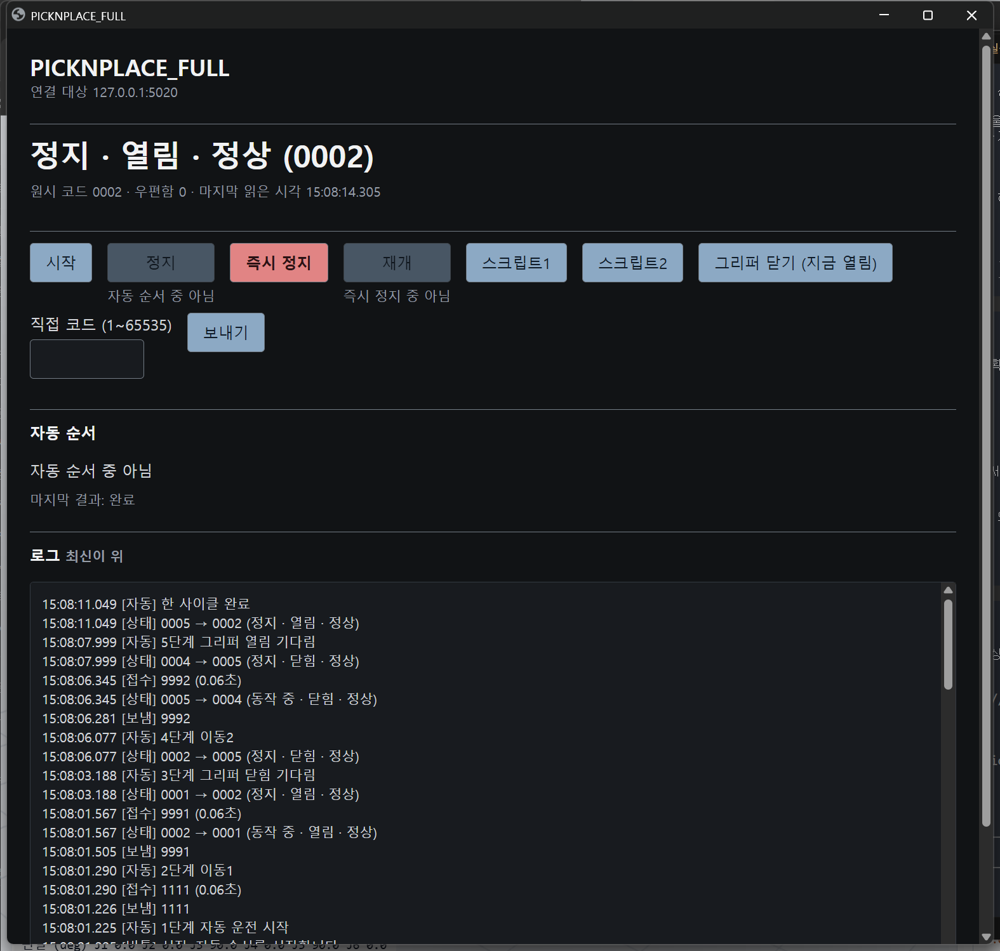

- 내장 모드와 같은 순서로 요청 3개(1111·9991·9992)와 완료 대기 4개를 거쳐 완료됐다.
- 파일 모드의 이동 시간(약 1.5초)은 내장 모드(약 2.2초)보다 짧았다. 이것은 가짜 실행기에서 스크립트 동작이 다른 결과이며, 실물 HCR 동작은 미검증이다.
- ES5 문법 제한은 가짜 실행기의 제한이다. 실행 오류 없이 돌았다.

## 직접 실행한 파일 모드 사이클과 화면 사진 (세 프로그램 가상장치, 2026-11-10 15:56)

8877의 시작 버튼을 직접 눌러 실행했다. 로봇은 파일 모드였다.

| 시각 | PC 로그 (캡처/USER_PC_155613_사이클.png) | 로봇 실행 로그 (캡처/USER_로봇_실행로그.png) |
|---|---|---|
| 15:56:13.869 | 시작 → 1단계, 1111 보냄 | |
| 15:56:13.934 | 1111 접수 (0.07초) → 2단계 이동1 | |
| 15:56:14.140 / 14.203 | 9991 보냄 / 접수, 0002 → 0001 | 15:56:14.271 DO0 → 1, 동작 중 |
| 15:56:15.869 | 0001 → 0002 → 3단계 그리퍼 닫힘 기다림 | 15:56:15.741 DO0 → 0, 쉼 |
| 15:56:18.755 | 0002 → 0005 → 4단계 이동2 | |
| 15:56:18.958 / 19.023 | 9992 보냄 / 접수, 0005 → 0004 | 15:56:19.032 DO0 → 1, 동작 중 |
| 15:56:20.646 | 0004 → 0005 → 5단계 그리퍼 열림 기다림 | 15:56:20.522 DO0 → 0, 쉼 |
| 15:56:23.703 | 0005 → 0002, 한 사이클 완료 | |

- 끝난 뒤 PC 화면: 0002, 마지막 읽은 시각 15:56:36.406, "자동 순서 중 아님 / 마지막 결과: 완료". 개별 버튼과 시작이 다시 허용됐다.
- 로봇 화면 (캡처/USER_로봇_파일모드.png): 학생 스크립트(Rodi Script 파일) 모드로 PICKNPLACE_FULL_main.js를 실행 중이고 상태는 "쉼"이다. 표시등 DI0~3과 DO0~1은 모두 꺼져 있다. 관절은 J1 0, J2 0, J3 90, J4 0, J5 90, J6 0으로 HOME이다. 화면 안내에는 "스레드의 moveStop은 실물 미확인", "스레드가 메인 전역 변수를 보는지도 실물 미확인"이 있다.
- PLC 화면 (캡처/USER_PLC_*.png): PICKNPLACE_FULL.xgwx이고 RUN, 로봇 1대 연결됨, Modbus 5020, 배선 5021이다. 사이클이 끝난 뒤 P00004·P00005·P00044~47·M00410~M00419는 모두 0이고, M00400(우편함 0)=1, M00420(명령 판정용 로봇 정지)=1이다.

### 래더로 확인한 판정 근거 (PLC 화면 사진)

| 관측 | 래더 근거 |
|---|---|
| RUN 직후 1111 거부 (14:59:14.822) | 렁 0: 첫 스캔에 M00418(그리퍼 열기)을 SET하고 3초 열기를 시작한다. 렁 46: 1111 접수 조건은 M00401·M00420(로봇 정지)과, M00416·M00417·M00418·M00410이 모두 OFF인 것이다. 열기 3초 동안에는 M00418=1이라 접수 조건이 깨지고, 렁 64에 따라 거부(M00439)가 된다. 렁 84에 따라 PLC 이상(M00419) SET → 상태 0008 |
| 9991·9992는 로봇 정지에서만 접수 | 렁 48·50: M00402/M00403과 M00420, 그리고 M00417·M00418 OFF. 렁 26: M00420 = 요청 없음 · DO0·DO1 OFF · 즉시 정지 아님. 그래서 PC가 robot==1을 새로 관측한 뒤 보내는 A의 규칙과 맞다 |
| 이동1 시작 확인 RUN1 | 렁 2: M00412(이동1 요청)와 P00004(로봇 DO0)가 함께 ON이면 M00414 SET, M00412 RST(DI0 요청 끔). 로그 14:57:48.485에서 M00414=1·P00044=0인 것과 일치 |
| 자동 그리퍼 닫힘·열림 | 렁 14: 자동 운전 중 스크립트1이 끝나면 M00417(닫기) SET. 렁 16: 스크립트2가 끝나면 M00418(열기) SET. 렁 20~24: 3초 뒤 닫힘·열림을 확정하고, 열기가 끝나면 M00410(자동 운전) RST. 그래서 PC는 3333을 보내지 않고 관측만 한다(B-1) |
| 즉시 정지·재개 | 렁 52: 9995는 언제나 접수. 렁 72: M00411 SET, 아직 받지 않은 요청 M00412·M00413 RST. 렁 54: 9993은 즉시 정지 중에만 접수. 렁 74: M00411 RST, P00046 재개 펄스 0.5초(렁 86·88). 렁 96: M00411 → P00047(DI3) |
| 9994 해제 | 렁 56: 로봇 정지·그리퍼 동작 중 아님일 때 접수. 렁 76: M00410 RST |
| 상태 코드 | 렁 102: M00425(비정상 정지) = P00005(DO1) 또는 M00411. 렁 104: M00424(동작 중) = M00412·M00413·P00004. 렁 106~128: M00419(이상)·M00416(닫힘)·M00424·M00425 조합으로 D01000 = 1~12 (예: 0003 정상·열림·비정상 정지, 0006 정상·닫힘·비정상 정지, 0008 이상·열림·정지) |

- 위 래더 해석은 가짜 PLC 화면에 표시된 내용이다. 화면 경고대로 SET/RST·상승 펄스의 의미와 래치 설정은 XG5000·실물과 대조하지 못했다.
